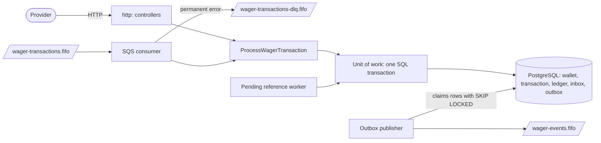
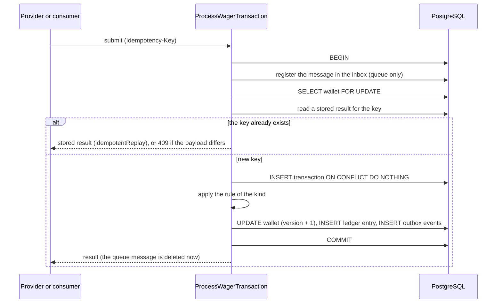
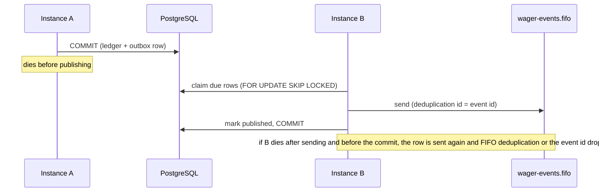

# Architecture

This document explains how the service is built, why, and where it stops. The sections follow the topics the challenge asks to justify: the ORM and the money mapping, the concurrency strategy, idempotency, the state model, the failure codes, authentication, and the interpretations I had to make.

## Overview

The service is a layered application with ports and adapters (the hexagonal style), written with the tactical patterns of Domain-Driven Design: `Wallet` is the aggregate root, `Money` is an immutable value object, and repositories and a unit of work hide the persistence. There is one bounded context on purpose. Splitting wallet and wagering would make each depend on the other, because the opening balance is itself a transaction. Strategic DDD (several contexts and a context map) is not applied, since the problem has a single context.

The dependency rule is that everything points inwards: `domain` imports nothing from the project, `application` defines the ports, and `infrastructure` and `http` implement or call them. It is kept by convention and review, not by an automated check, and the AWS SDK is imported in a few places outside `infrastructure/sqs` (health, module wiring and the workers bootstrap).

The code has four layers:

- `domain`: `Money`, `Wallet`, `WalletLedgerEntry`, `WagerTransaction`, `InboxMessage`, `OutboxMessage` and the integration events. Plain TypeScript. The only external dependency is `decimal.js`, through `Money`.
- `application`: the use cases (open a wallet, process a transaction, retry pending references, record a permanent failure, the read queries) and the ports they need (repositories, unit of work, clock, logger, metrics).
- `infrastructure`: PostgreSQL persistence with MikroORM, the SQS publisher and consumer, the background workers, health checks, logs, metrics and traces.
- `http`: controllers, the error mapper and the authentication extension point.

The application layer has no port for publishing messages. Only the outbox publisher in `infrastructure/sqs` talks to SQS, so a use case cannot publish an event before its transaction commits, even by mistake.

The same use case serves HTTP and SQS. The consumer only adds the inbox record and the error classification around it.

A wallet is the unit of concurrency. A transaction is applied inside one SQL transaction that touches the wallet, the transaction row, the ledger, the inbox and the outbox.

## Diagrams

How the pieces fit together. HTTP and the queue reach the same use case, and everything the use case changes is committed in one SQL transaction. Only the outbox publisher talks to the events queue.

What happens to one submission. The wallet is locked first, then the idempotency row is inserted, then the rules are applied. The response goes out, or the queue message is deleted, only after the commit.

Crash between the commit and the publication. The event is already in the outbox, so another instance publishes it, and a second publication is harmless.

## Security and container hardening

This section comes early because the service moves money, and a container that runs as root with all its privileges is the first thing a reviewer should not find. The measures are small and each one is checked. What is not covered is listed at the end.

### The application containers

Every container built from the application image (`migrate`, `app` and `tests` in `docker-compose.yml`) runs with the following restrictions. The compose settings live in the shared `x-app` block, so no service can miss them.

| Measure | Where | What it does | Why |
|---|---|---|---|
| Non-root user | `Dockerfile`: `USER bun`, `COPY --chown=bun:bun` | the process runs as `bun` (uid 1000), the unprivileged user that the official `oven/bun` image already provides | a bug or a compromised dependency does not get root inside the container |
| No new privileges | compose: `security_opt: no-new-privileges:true` | the process and its children cannot gain privileges, for example through a setuid binary | closes the usual escalation path |
| No Linux capabilities | compose: `cap_drop: [ALL]` | the effective capability set is empty | the service only listens on port 3000 and talks to PostgreSQL and SQS, so it needs none |
| Read-only root filesystem | compose: `read_only: true` and `tmpfs: /tmp` | the container cannot write anywhere except an in-memory `/tmp` | a compromised process cannot drop or change files, and the service keeps all its state in PostgreSQL anyway |
| Technology header removed | `src/create-app.ts`: `x-powered-by` disabled | responses no longer say `X-Powered-By: Express` | does not advertise the stack |
| Graceful stop window | compose, `app` only: `stop_grace_period: 30s` | Docker waits up to 30 seconds after `SIGTERM` before it kills the process | the default is 10 seconds, and 30 gives requests and queue messages in progress time to finish. A message that is still cut is delivered again after its visibility timeout and applied once, so the longer window only avoids needless redeliveries |

The user is the `bun` user of the base image and not a custom one because it needs no extra configuration. It can be replaced by another user or a numeric uid in the `Dockerfile` (`USER`) without touching the code.

### How it was checked

- `docker inspect` of the three `app` replicas and of the `migrate` container reports `ReadonlyRootfs=true`, `CapDrop=[ALL]`, `SecurityOpt=[no-new-privileges:true]` and `User=bun`, and `migrate` applied the migrations with the read-only filesystem.
- Inside the container the process is uid 1000, its effective capability set is zero, writing to `/app` fails with "Read-only file system" and `/tmp` is writable.
- The `tests` container has the same restrictions, so `docker compose --profile test run --rm tests` runs the whole suite (unit, integration and multi-instance) under them, and it passes. The multi-instance test starts real application processes inside that container, so they also run without root and without privileges.
- `http-api.test.ts` checks that no response carries `X-Powered-By`, errors included, and that a body above 100 kB is refused with `413`.
- With three replicas behind the gateway, the README commands gave the documented answers: a processed bet, its replay, the `409` conflict, the `422` for missing funds, the ledger and a consistent reconciliation. Two bets of 80.00 on a 100.00 wallet, answered by two different replicas, gave one `PROCESSED` and one `REJECTED` with a balance of 20.00. Stopping the replicas took at most 2 seconds and ended with exit code 0.

### What the HTTP layer does not reveal

- An unexpected error answers `500` with a fixed body (`INTERNAL_ERROR`, "unexpected error"). It never carries a stack trace, a file path or SQL. The log keeps only the error name and message, not the stack.
- A request body above 100 kB, the default limit of the HTTP layer, is refused with `413` in the same error format as every other error. Every payload is then validated by a schema before it reaches the use case, and fields the schema does not know are dropped, so they are never stored or hashed.
- A text field, or an id in the path, with a null byte is rejected as `400 INVALID_COMMAND`. PostgreSQL refuses a null byte in text with SQLSTATE `08P01`, and that code is not treated as a transient error, because retrying a request that is invalid by construction can never succeed.
- Database access is parameterised through the ORM, so a SQL fragment in a path or a field is data, not code.

### What is not covered

- The `gateway` (nginx) container has none of these restrictions. Apart from `server_tokens off`, which keeps its version out of the `Server` header, its configuration is a plain reverse proxy: no TLS, no rate limiting, and only the default nginx body size limit. It also adds an `X-Upstream` header with the internal address of the instance that answered, which is useful to see the load balancing and should be removed in a real deployment.
- Jaeger runs with its default configuration: no authentication on its UI, traces kept in memory, and none of the restrictions above.
- PostgreSQL and LocalStack run as the development images they are, with the development credentials written in `docker-compose.yml`. A real deployment would take the credentials from a secret store.
- The application connects to PostgreSQL with a role that owns the schema. A runtime role with only `SELECT` and `INSERT` on the ledger would add a barrier next to the triggers.
- Authentication is a no-op extension point (see Authentication). There is no per-provider authorization.
- The base image is pinned by tag (`oven/bun:1.4.4`), not by digest, and the dependencies are not scanned automatically beyond a manual `bun audit`, which reported no known vulnerabilities.

## Money

`Money` is an immutable value object around a `Decimal`. The amount enters and leaves as a string with exactly two decimals, and the currency is three uppercase letters.

Input is validated with a strict pattern before any `Decimal` is created, so `NaN`, `Infinity`, scientific notation, an empty string, a comma, a sign, a space, digits of other alphabets and more than two decimals are all rejected. There is no rounding anywhere: an amount that needs rounding is rejected instead of silently losing a cent. An amount accepts at most 17 integer digits, which is what `numeric(19,2)` can store, so the domain never accepts something the database cannot hold.

The results of `add`, `subtract` and `negate` can be negative (a reconciliation difference is an example), so only `Money.from`, the door for external data, rejects negatives. A wallet never holds a negative balance: that is enforced by the wallet and, independently, by a `CHECK` in the database.

Operations between different currencies throw a domain error. The model is multi-currency, but in practice the tests use BRL, plus USD where a currency conflict has to be shown.

In the database an amount is `numeric(19,2)` and a currency is a separate `char(3)` column. MikroORM reads `numeric` back as a string and the mappers hand that string to `Money.from`, so a money value never passes through a JavaScript `number`. A test (`money-guard.test.ts`) fails if a number conversion (`parseFloat`, `parseInt`, `Number(`) appears in production code outside two known cases (a page size and a receive count), if the money classes declare a `number`, or if a migration uses a floating point type.

## ORM and persistence

I used MikroORM, as the statement prefers. The records are `EntitySchema` definitions (no decorators), kept apart from the domain classes. Mappers convert in both directions, and the domain classes are rebuilt with `rehydrate`, which does not revalidate transitions. The domain therefore knows nothing about the ORM.

A unit of work wraps `em.fork().transactional(...)`. It hands the use case repositories that are already bound to the transaction, so wallet, transaction, ledger, inbox and outbox commit together or not at all. It also sets `SET LOCAL lock_timeout` (5 seconds) so a long wait becomes a transient error instead of hanging. Lock timeouts, deadlocks, serialization failures and connection errors are translated into a transient infrastructure error, which HTTP maps to 503 and the consumer retries.

Schema changes are hand-written SQL migrations, because triggers, partial indexes and check constraints cannot be generated reliably. Each migration has a `down`.

## Concurrency

Strategy: pessimistic locking per wallet. A use case reads the wallet with `SELECT ... FOR UPDATE` (`LockMode.PESSIMISTIC_WRITE`) and keeps the lock until the transaction ends. Different wallets never block each other, and there is no global lock. The lock lives in PostgreSQL, so it holds across any number of application instances.

The wallet `version` is a second barrier. The update is `WHERE id = ? AND version = ?`, and zero updated rows is a transient error. The row lock should make that impossible, so it only guards against a bug.

Why not the alternatives:

- Optimistic locking with retries needs a retry loop, and under a hot wallet it wastes work and can starve. The pessimistic version is deterministic and easy to prove.
- A conditional atomic `UPDATE wallet SET balance = balance - x WHERE balance >= x` is simple, but each ledger entry stores `balance_before` and `balance_after`, so the balance has to be read in the same step.

Lock order inside a transaction is fixed: lock the wallet, then insert the idempotency row, then resolve the reference. I first did it the other way, and a test with ten parallel bets deadlocked. Inserting the transaction row takes a `FOR KEY SHARE` lock on the wallet row because of the foreign key, and two concurrent transactions then both asked for `FOR UPDATE`, each waiting for the other. Locking the wallet first removes the cycle. A side effect is that a request for a wallet that does not exist is detected at the lock.

## Idempotency

`Idempotency-Key` is required, and it is the source of truth. The usual value is `{providerId}:{externalTransactionId}`. Queue messages carry their own key, with the same default.

Everything lives in the database, so any instance sees the same answer:

- `UNIQUE (idempotency_key)` and `UNIQUE (provider_id, external_transaction_id)` on `wager_transaction`.
- The transaction row is inserted with `INSERT ... ON CONFLICT DO NOTHING`. If it was not inserted, the existing row is read. The same payload hash returns the stored result with `idempotentReplay: true`. Another payload hash is a conflict (409), not a replay.
- A business rejection is committed as a `REJECTED` row with the balance observed at that moment, so its replay is stable. A technical failure rolls everything back, key included, and the provider can send the same request again.
- A replay returns the balance observed when the transaction was first applied, not the current one.

`payloadHash` is the SHA-256 (hex) of a canonical JSON of the business fields: provider id, external transaction id, player id, wallet id, round id, game id, kind, money (normalized by `Money`) and the reference id when there is one. The canonical JSON sorts the keys at every level and drops undefined values. The idempotency key, headers and transport metadata are not part of it.

## Schema guarantees

The invariants live in the database, not only in the code:

- `wallet`: `CHECK (balance >= 0)`, `CHECK (version >= 1)`, `UNIQUE (player_id, currency)`.
- `wager_transaction`: the two unique constraints above, checks for the allowed kinds and statuses, a reversal must carry a reference, a `REJECTED` or `FAILED` row must carry a failure code, a `PROCESSED` row must carry its time. A partial unique index allows only one `PROCESSED` reversal (REFUND or ROLLBACK) per referenced transaction.
- `wallet_ledger_entry`: positive amount, non-negative balances, a check that `balance_before` plus or minus the amount equals `balance_after` according to the direction, and `UNIQUE (transaction_id, wallet_id)`. A row trigger rejects `UPDATE` and `DELETE`, and a statement trigger rejects `TRUNCATE`, so the ledger is append-only.
- `inbox_message`: primary key `(consumer_name, message_id)`.
- `outbox_message`: a partial index over the unpublished rows.

## Transaction states

`PENDING` is where every transaction starts. `PROCESSED`, `REJECTED` and `FAILED` are terminal, and any transition out of them throws `InvalidTransactionStateError`, because it would be a programming error and not a business path.

| From | To | When |
|---|---|---|
| `PENDING` | `PROCESSED` | the rule was applied |
| `PENDING` | `REJECTED` | a business rule was violated |
| `PENDING` | `PENDING_REFERENCE` | the referenced transaction does not exist yet |
| `PENDING` | `FAILED` | a permanent infrastructure failure was recorded |
| `PENDING_REFERENCE` | `PENDING_REFERENCE` | another retry, the reference is still missing |
| `PENDING_REFERENCE` | `PROCESSED`, `REJECTED` or `FAILED` | the reference showed up, or the limit was reached |

`OPENING` is a kind used only internally for the initial balance of a wallet. The API and the queue reject it.

## Failure codes

Every rejection carries a stable, machine readable code. This is what the provider should do with each one.

| Code | Meaning | Provider should |
|---|---|---|
| `INSUFFICIENT_FUNDS` | a bet needs more than the balance | stop, or retry later with a new transaction |
| `REVERSAL_WOULD_OVERDRAW` | undoing the reference would make the balance negative | do not retry, it needs a human |
| `REFERENCE_NOT_FOUND` | the reference never arrived within the retry limit | check the reference id, then send a new transaction |
| `REFERENCE_NOT_PROCESSED` | the reference exists but was rejected or failed | give up, there is nothing to revert |
| `REFERENCE_MISMATCH` | the reference belongs to another player, wallet, round or currency | fix the payload |
| `INVALID_REFERENCE_KIND` | the reference has a kind this operation cannot point to | fix the payload |
| `REFERENCE_ALREADY_REVERSED` | the reference already has a processed reversal | give up |
| `AMOUNT_MISMATCH` | the reversal amount differs from the reference amount | fix the payload |
| `CURRENCY_MISMATCH` | the currency differs from the wallet currency | fix the payload |
| `PLAYER_MISMATCH` | the player does not own the wallet | fix the payload |
| `PERMANENT_ERROR` | the transaction was recorded as `FAILED` after infrastructure retries ran out | send a new transaction with another id |

A rejection after the key was used cannot be retried with the same key: the replay returns the same rejection. To try again the provider sends a new external transaction id.

## References and out of order delivery

REFUND and ROLLBACK need a reference. A WIN may carry one. The reference is looked up by provider and reference id, and it has to belong to the same player, wallet, currency and round. A REFUND points only to a BET. A ROLLBACK points to a BET, a WIN or a REFUND, and a WIN points only to a BET.

If the reference is missing, or it is itself still waiting, the transaction is stored as `PENDING_REFERENCE`, a `WagerTransactionPendingReference` event is published once, and a worker retries it. The delay doubles from 1 second up to 5 minutes. After 10 attempts, about 13 and a half minutes, it becomes `REJECTED` with `REFERENCE_NOT_FOUND` and a `WagerTransactionRejected` event. A provider that sends a reversal before its bet normally only disagrees by seconds, so the window is generous and still bounded.

Two workers can pick the same pending row. Each one locks the wallet first and reads the row again, so the second finds it already resolved and skips it.

Reversal amount must equal the reference amount. A reversal that would make the balance negative is rejected with its own code, different from a bet without funds. A ROLLBACK applies the inverse direction of what it reverts and keeps the amount positive.

### One reversal per reference

The statement forbids reverting a reference twice with the same kind. I made it stricter: a reference accepts one processed reversal of any kind. Read literally, a bet could receive a REFUND and then a ROLLBACK, and the player would be credited twice for one bet. The price is that a refund that was itself rolled back cannot be redone. It is enforced in the use case and, independently, by a unique index, and a schema test shows the index rejecting a second processed reversal on its own.

## Outbox and publishing

Events are written to `outbox_message` in the same SQL transaction as the change that caused them. Four events exist: `WagerTransactionProcessed`, `WagerTransactionRejected`, `WalletBalanceChanged` (only when the balance moves) and `WagerTransactionPendingReference`. Each one is a class with its type and version in the type, and its data carries money as strings.

A publisher claims up to 20 due rows with `FOR UPDATE SKIP LOCKED` and sends them to `wager-events.fifo` with `SendMessageBatch`, ten per call. The group id is the wallet id and the deduplication id is the event id. Only the entries that SQS confirms are marked published. Any other entry, refused by SQS or missing from its answer, is scheduled for a retry, and then the claim commits. Several publishers get different rows. A publisher only sees rows that were already committed, so nothing is published before the financial commit.

If the process dies before sending, the transaction of the publisher is rolled back and another instance takes the rows. If it dies after sending and before committing, the row is sent again later. The event id is stable and FIFO deduplication drops the second copy inside its window, and consumers must deduplicate by event id anyway. A failed send keeps the row with `attempts + 1` and a delay that doubles.

## SQS consumer

The consumer reads `wager-transactions.fifo`, runs the same use case as HTTP and registers the message in the inbox inside the same transaction. It deletes the message only after the use case returns, which is after the commit. A redelivery therefore finds the stored result and changes nothing.

It sorts errors in three kinds:

- Business errors (unknown wallet, idempotency conflict) are acknowledged, because retrying cannot change the outcome.
- Permanent errors (invalid JSON, wrong type, an invalid amount or field) go straight to the dead-letter queue with a `failureReason`.
- Anything else keeps the message in the queue with a visibility delay of 2^n seconds (at most 60). The retry limit is the queue's own redrive after 5 receives.

When the limit is reached, the cause decides what happens. If it was an infrastructure failure, the transaction is recorded as `FAILED` and the queue moves the message to the dead-letter queue. If it was an unexpected error, which is probably a bug, the message goes to the dead-letter queue without a `FAILED` record, so it can be sent back to the main queue once the bug is fixed.

On shutdown the consumer finishes the message it is processing and gives back the others of the batch.

`FAILED` is never created by the HTTP path, where a technical failure rolls everything back and the provider retries, and not for invalid payloads, which have nothing valid to store.

## HTTP API

The paths are the ones in the statement, with no version prefix. A single error mapper serves every endpoint:

| Status | Meaning |
|---|---|
| 200 | processed, or the replay of a processed transaction |
| 202 | accepted, waiting for its reference |
| 400 | invalid payload or header |
| 404 | a read for something that does not exist |
| 409 | idempotency conflict, or a wallet that already exists for that player and currency |
| 422 | rejected by a business rule (with the failure code), unknown wallet on submit, or a permanent failure |
| 503 with `Retry-After` | transient infrastructure failure, send the same request again |
| 500 | anything unexpected, with a generic body |

Ledger pages are ordered by an identity column and use an opaque cursor that holds the last sequence. A page is read with one extra row to know whether another page exists, and new entries land at the end, so a cursor never repeats or skips an entry.

Reconciliation locks the wallet briefly, so the stored balance and the ledger sum come from the same moment. A difference is logged as an error, counted in a metric and returned in the response, and nothing is corrected silently.

## Observability

Logs are JSON, one event per line, with `correlationId`, `transactionId`, `walletId`, `providerId` and `messageId` where they apply, and never an amount or a payload. A request for a wallet that does not exist is logged with the provider, the wallet asked for and the idempotency key, and counted.

Metrics are recorded with the OpenTelemetry SDK and served by each instance at `/metrics`, in the Prometheus text format: transactions by status, duplicates detected, retries by kind, messages sent to the dead-letter queue, lock conflicts, outbox lag, processing latency, unknown wallets and reconciliation divergences. Every counter (the transactions of each answered status and the retries of each kind included) and the outbox lag start at zero, so they are visible before their first event. The latency histogram appears with the first transaction, because OpenTelemetry exports a histogram only once it has a measurement. The statement does not ask for a format, and this one needs no extra infrastructure. The first version used `prom-client`, which is now deprecated in favour of another client. The OpenTelemetry SDK replaced it with the same names, labels and histogram buckets, and sending the metrics to an OpenTelemetry collector would only need another exporter.

Traces use the same SDK and are sent over OTLP/HTTP to Jaeger, which is part of `docker-compose.yml` and shows them at `http://localhost:16686`. There are four kinds of span, all in the outer layers, so the application layer is untouched:

- one span for each HTTP request, named after the method and the route, with the status code (a 5xx marks it as an error). Health checks and `/metrics` are not traced;
- `sqs.consume` for each message of the input queue, with the message id, the receive count, the resulting status or the outcome of the error classification;
- `outbox.publish` for each claim of the publisher that found events, with how many were claimed and how many SQS confirmed;
- `db.transaction`, inside any of the above. It covers the whole SQL transaction, so on a hot wallet its duration includes the wait for the wallet lock. It is created only when there is an active span, so idle workers produce no traces.

Tracing is off unless `OTEL_EXPORTER_OTLP_ENDPOINT` is set, and only the `app` service has it in Compose, so the tests and the load test never send traces. Jaeger is not a dependency of the service: the spans are exported in batches in the background, and with Jaeger stopped the API kept answering and `/health/ready` stayed green. The trace context is not carried through the queue or the events, so a bet received over HTTP and the message or the outbox batch that follows it are separate traces.

`/health/live` answers as long as the process is up. `/health/ready` checks PostgreSQL and SQS and returns 503 if either is down. Both are open.

## Authentication

Not implemented, as the statement allows. The extension point is explicit: a global `NoopAuthGuard`, which can be replaced without touching a controller. Health and metrics would stay open, and queue messages are treated as a trusted internal channel, with the same domain validations as HTTP.

The design I would adopt: an external identity provider (Keycloak or Zitadel) with OpenID Connect and the client credentials flow, one client per game provider. The guard validates the signed token and takes the provider identity from a claim, and a `ProviderIdentityPort` compares that identity with the `providerId` in the body, so one provider cannot act for another. Wallet endpoints used by operators would need a role claim.

## Testing

Everything that matters runs against a real PostgreSQL and a real LocalStack, in containers. The only test double is a stub of the processing use case in the single test that needs an unexpected error. Failures are provoked with real means: a row lock held by another connection, a dead SQS endpoint, a queue whose size limit makes SQS refuse one message of a batch, a process killed with `process.exit` at an exact point, and a process killed with `SIGKILL`. The crashing publisher runs the real publisher with the real SQS client, wrapped so that the process dies right before or right after the real call. The consumer test for the receive limit releases its held lock from a wrapper around the real unit of work, right before the failure is recorded, instead of after a timer.

- Unit tests: money, wallet, ledger entry, transaction transitions, outbox and inbox, events, the payload hash, the command and message parsing (null bytes included), the translation of database errors, the error mapper, the cursor, the metrics output, the configuration and the worker loop.
- Integration tests: the migrations (all reverted and applied again, leaving the same schema), constraints and triggers, atomicity, idempotency, all the rules, reversals and pending references, the HTTP API (the whole application on a random port), the publisher (batches of ten, a batch that SQS refuses in part, SQS down), the consumer, and the traces (a bet is one HTTP span with its database transaction inside, and health checks are not traced).
- Concurrency tests: the same bet 50 times in parallel, two bets of 80.00 on a 100.00 wallet, ten parallel bets on one wallet, wallets in parallel, a reversal racing with its own bet, several publishers and consumers, a worker killed after the commit and before the ack, and a publisher killed before and after sending.
- The multi-instance test starts three real processes of the application (the size is configurable, and it also passes with 12), sends mixed HTTP and SQS traffic with duplicates in shuffled order, kills one instance with `SIGKILL`, restarts it and waits for the system to settle. Then it checks that each transaction exists once, that every wallet balance equals the balance rebuilt from its ledger, that the outbox is fully published and that the dead-letter queue is empty.

### Guarantees and the tests that prove them

| Guarantee | Mechanism | Proved by |
|---|---|---|
| Money is exact | `Decimal` in the domain, `numeric(19,2)`, strict two-decimal strings, no rounding | `money.test.ts`, `money-guard.test.ts` |
| Balance never negative | rule in `Wallet` and `CHECK (balance >= 0)` | `schema.test.ts`, two 80.00 bets on a 100.00 wallet |
| No lost update | `SELECT ... FOR UPDATE` per wallet, `version` as a second barrier | ten parallel bets on one wallet, `persistence.test.ts` |
| Ledger is immutable | triggers on `UPDATE`, `DELETE` and `TRUNCATE` | `schema.test.ts` |
| One reversal per reference | partial unique index | `reversals.test.ts` |
| Persistent idempotency | `UNIQUE (idempotency_key)`, `UNIQUE (provider_id, external_transaction_id)`, `INSERT ... ON CONFLICT DO NOTHING` | `process-wager.test.ts`, the same bet 50 times in parallel |
| Redelivery changes nothing | inbox with primary key `(consumer_name, message_id)` | `process-wager.test.ts`, `sqs-consumer.test.ts` |
| Nothing is published before the commit | outbox row in the same transaction, only the publisher talks to SQS | `outbox-publisher.test.ts` |
| No event is lost | the outbox row stays pending until SQS confirms the event, and a failed or refused send is retried | `outbox-publisher.test.ts`: SQS down, an entry refused by SQS, a publisher killed before sending |
| Every balance change has its ledger entry, and the reverse | both are written in the same transaction, and a `CHECK` validates the arithmetic of each entry | the invariant checked after every test (below) |
| Migrations are reversible | every migration has a `down` | `migrations.test.ts` |

### Scenarios required by the statement

| Scenario | Test |
|---|---|
| The same BET 50 times in parallel gives one debit | `process-wager.test.ts`: "the same bet sent 50 times in parallel debits once" |
| Two 80.00 bets on a 100.00 wallet: one PROCESSED, one REJECTED, balance 20.00 | `process-wager.test.ts` and `persistence.test.ts`: "two 80.00 bets on a 100.00 wallet..." |
| Different wallets in parallel | `process-wager.test.ts` and `persistence.test.ts`: "different wallets are processed in parallel" |
| Three or more instances | `multi-instance.test.ts` (three real processes) and `sqs-consumer.test.ts`: "three consumers on the same queue apply every message exactly once" |
| Worker killed after the commit and before the ack | `sqs-consumer.test.ts`: "a worker process that dies after the commit and before the ack causes no duplicate" |
| Two publishers on the same outbox, and a publisher that dies | `outbox-publisher.test.ts`: "concurrent publishers" and "a publisher process that dies" |
| ROLLBACK or REFUND before the reference | `reversals.test.ts`: "references that arrive late" |
| Restart with proof of consistency | `multi-instance.test.ts`: one instance killed with `SIGKILL`, restarted, final state checked |

Every test that goes through the application or its repositories ends with the invariant the statement asks for: an `afterEach` hook checks that every wallet in the test's database has a stored balance equal to the balance rebuilt from its ledger. Each of these test files gets its own database, created again on every run, so the check covers every wallet the file created and nothing else. Two places break the invariant on purpose. The schema tests insert raw rows to prove each constraint, in a database this check does not read. The reconciliation test changes a balance behind the application to prove that the divergence is detected, and then puts it back; without that last step the check fails and names the wallet, which was verified. The queues are separate copies too, so a running application never interferes.

### Load test

`bun run test:load` is the optional differential of the statement. It drives real application processes over HTTP and checks the same invariants as the other tests after each scenario.

Environment: one laptop runs everything, Linux 6.18.9 (Kali) on an Intel Core i5-13450HX (16 logical CPUs) with 7.5 GiB of RAM, Bun 1.4.4, PostgreSQL 16.14 and LocalStack 3.8.1 in Docker. The three application processes, the database, LocalStack and the load generator share it with a browser and the editor, and the machine was using swap during the runs.

Method:

- Each run creates a new database, purges the test queues and starts three instances as real processes.
- The generator keeps 64 requests in flight and sends each one to a random instance. Latency is measured by the client, from sending a request to reading its whole response.
- A request that gets no HTTP answer, because its connection failed, is sent again with the same `Idempotency-Key`, up to three times, as a provider would. The report counts those requests apart from the errors, which are 5xx answers and requests that never got an answer, and shows the error rate of each scenario.
- Lock conflicts are the growth of `wager_lock_conflicts_total` over the instances. The max outbox lag is the highest `outbox_lag_seconds` sampled every 500 ms, and a scenario only ends when every instance reports a lag of zero again. The outbox drain is the time from the last response until no outbox row is left unpublished.
- Scenarios: spread, 20,000 transactions over 200 wallets (60% BET, 30% WIN and 10% LOSS, all of 1.00); hot wallet, 5,000 transactions with the same mix on one wallet; duplicate storm, 50 distinct BETs over 10 wallets, each sent 100 times in shuffled order.
- After each scenario every stored balance must equal the balance rebuilt from its ledger, with no negative balance, no duplicated ledger entry and every transaction processed.

Three runs on the final code:

| Scenario | Run | Req/s | p50 ms | p95 ms | p99 ms | Max outbox lag s | Outbox drain s |
|---|---|---|---|---|---|---|---|
| spread | 1 | 1584 | 35.8 | 82.0 | 129.0 | 9.5 | 9.6 |
| spread | 2 | 697 | 41.0 | 107.4 | 1917.6 | 13.1 | 8.8 |
| spread | 3 | 1593 | 36.1 | 79.8 | 111.9 | 8.5 | 8.0 |
| hot wallet | 1 | 233 | 226.4 | 569.7 | 829.6 | 2.0 | 0.3 |
| hot wallet | 2 | 238 | 180.7 | 614.1 | 667.7 | 0.5 | 0.3 |
| hot wallet | 3 | 256 | 207.4 | 523.6 | 588.0 | 1.4 | 0.3 |
| duplicate storm | 1 | 937 | 21.2 | 357.6 | 384.7 | 0.7 | 0.0 |
| duplicate storm | 2 | 2767 | 19.7 | 49.5 | 64.6 | 0.0 | 0.0 |
| duplicate storm | 3 | 1876 | 30.6 | 71.1 | 90.9 | 0.0 | 0.0 |

Every scenario of every run had an error rate of 0% (no 5xx answer and no request left without an answer), no lock conflict and no request to resend, passed every check above and left the dead-letter queue empty. The duplicate storm created exactly 50 transactions with 50 debits and answered the other 4,950 requests as replays.

What the numbers show:

- Wallets in parallel scale: about 1,600 requests per second, with a p99 of 110 to 130 ms in the normal runs.
- A hot wallet serializes, as designed. One wallet took about 230 to 260 operations per second, about 4 ms each under its lock. With 64 requests in flight, each one waits for the ones ahead of it: by Little's law they spend 64 / 240 per second, about 0.27 s, on average, which is consistent with the measured p50 of 0.18 to 0.23 s and p95 of 0.52 to 0.61 s. No request reached the 5 s lock timeout.
- A replay is cheap: it locks the wallet, reads the stored result and writes nothing, so the storm ran at about 1,900 to 2,800 requests per second outside the slow run.
- Under the spread load the outbox falls behind by 8.5 to 13 s and catches up within 10 s after the load stops. Batching keeps it there: an earlier comparison on the same machine, alternating the two versions three times each at similar throughput, gave a max lag of 66 to 69 s with one SQS call per event and about 10 s with batches of ten.
- Two scenarios were slower: the spread of run 2 and the duplicate storm of run 1. In the spread of run 2 the machine nearly stopped for about 13 seconds, as `vmstat` showed: user CPU fell to 2 to 18%, IO wait rose to 20 to 70%, up to 28 processes were blocked and context switches fell from about 190,000 to under 50,000 per second. Then more than 120 MB came back from swap in three seconds and the load resumed. The normal scenarios averaged 5 to 6% of IO wait, with at most 3 blocked processes. The processes were waiting for memory pages, not working. A request holds its wallet lock until its commit, so a process that pauses while holding it delays every request for that wallet, which turns a short pause into a long tail.
- An earlier run on the same code had one request lose its connection (`ECONNRESET`) during a pause like this, before any answer. That transaction was not applied, which is the correct outcome, and the run was flagged because a transaction was missing. A provider sends such a request again with the same key, so the load test now does the same.
- These numbers compare scenarios and versions on one machine. They are not a capacity figure: the generator, the database and LocalStack compete for the same CPUs and memory, and LocalStack is not SQS.

## Interpretations and decisions

- An amount needs exactly two decimals: `"25"` and `"25.5"` are rejected.
- One processed reversal per reference, of any kind.
- A WIN with a reference follows the same checks as a reversal, but its amount does not have to match the bet and several WINs may point to one bet.
- A request for a wallet that does not exist answers 422 and stores nothing, to keep the foreign key strict. The attempt is logged and counted.
- A `FAILED` transaction answers 422 with `PERMANENT_ERROR`: the provider must not resend it with the same id.
- A third queue, `wager-events.fifo`, carries the outbox events. Otherwise the consumer would read its own events. The tests use their own copies of the queues so they can run while an instance is consuming the real ones.
- LocalStack is pinned to 3.8.1, because newer images refuse to start without an account token, and a reviewer would not have one.
- Jaeger is always on in `docker-compose.yml`, with a pinned image (`jaegertracing/jaeger:2.22.0`). A reviewer who starts the system can open the traces without any extra command, and the application works the same without it.
- Instances are exposed behind a small nginx gateway, because the statement says nothing about it and a port range gave unpredictable ports.

## Limits and trade-offs

- A very hot wallet serializes: every operation on it queues on one lock, and in the load test one wallet took about 230 to 260 operations per second. That is the price of the simple, provable strategy.
- The order of the events of one wallet is not guaranteed with concurrent publishers. Events carry `occurredAt` and, for balance changes, `walletVersion`, so a consumer can order them.
- The publisher calls SQS while it holds the row locks. A claim takes at most 20 rows, two batch calls, to keep that short.
- A long database outage would exhaust the retries of messages that are fine and send them to the dead-letter queue, recording them as `FAILED`. A circuit breaker that pauses consumption while the database is down would avoid that, and I did not build it.
- There is no tool to send dead-letter messages back to the main queue. The idempotency would make it safe, and it is the natural next step.
- The ledger triggers do not stop the owner of the table, who can disable them. The application should connect with a role that can only `SELECT` and `INSERT` on the ledger. I did not do that.
- Currencies are only checked for the pattern of three uppercase letters, not against the ISO list.
- The ledger is single-entry. A double-entry ledger is an optional extra that I left out, because it changes the constraints that sustain the financial guarantees.
- There is no dashboard, which is optional in the statement. Tracing is deliberately small: four kinds of span, kept in memory by Jaeger, with no sampling and no trace context carried through the queue or the events, so a request and the message or the outbox batch that follows it are separate traces.
